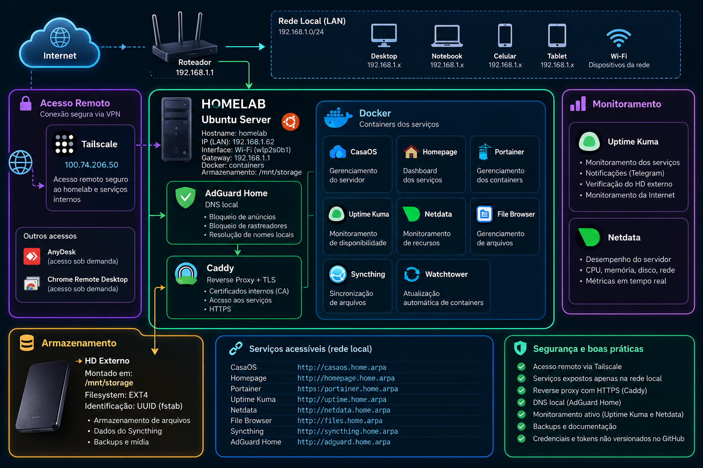

# 🏠 Homelab

Projeto de homelab desenvolvido para estudo e prática de administração de sistemas, Linux, redes, Docker, monitoramento, armazenamento e acesso remoto.

O ambiente utiliza um notebook com Ubuntu Server como servidor principal e concentra serviços de infraestrutura executados principalmente através de containers Docker.

> Este repositório contém documentação e exemplos de configuração.
> Credenciais, tokens, certificados, bancos de dados e demais informações sensíveis não são armazenados no GitHub.

---

## 🖥️ Servidor

| Item | Configuração |
|---|---|
| Hostname | `homelab` |
| Sistema operacional | Ubuntu Server |
| IP LAN | `192.168.1.62/24` |
| Gateway | `192.168.1.1` |
| Interface principal | Wi-Fi (`wlp2s0b1`) |
| VPN | Tailscale |
| Armazenamento externo | `/mnt/storage` |
| Filesystem externo | EXT4 |
| Containerização | Docker |

O endereço IP do servidor é configurado de forma estática através do Netplan.

---

## 🧱 Arquitetura

Fluxo simplificado da infraestrutura:

```text
                         INTERNET
                            │
                            ▼
                         ROTEADOR
                            │
                            ▼
                    ┌────────────────┐
                    │     HOMELAB    │
                    │  Ubuntu Server │
                    │ 192.168.1.62   │
                    └───────┬────────┘
                            │
             ┌──────────────┴──────────────┐
             │                             │
             ▼                             ▼
         AdGuard Home                  Tailscale
             │
             ▼
           Caddy
      Reverse Proxy + TLS
             │
             ▼
      Docker Network: homelab
             │
    ┌────────┼─────────┬──────────┐
    │        │         │          │
    ▼        ▼         ▼          ▼
Homepage  Portainer  Uptime     Netdata
                    Kuma
    │
    ├── File Browser
    ├── Syncthing
    └── outros serviços
```


### Diagrama da infraestrutura



O diagrama apresenta a organização dos principais componentes da infraestrutura, incluindo rede local, acesso remoto, serviços Docker, DNS, reverse proxy, monitoramento e armazenamento.

---

## 🐳 Serviços
